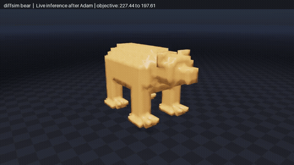
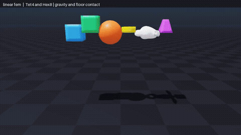
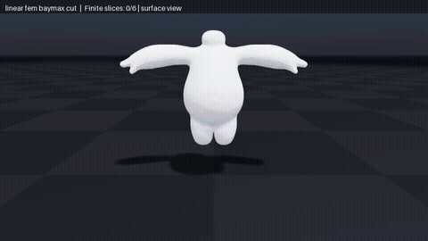

<!-- Generated by tools/build_readme.py; edit pyproject.toml and the sources in docs/. -->
# newton-solver-fem

Self-contained sparse Tet4/Hex8 FEM and interactive cutting for Newton.

## Run

From this directory:

```bash
./docker/build.sh
./docker/run.sh                 # Choose an automatically discovered example.
./docker/run.sh --list          # List examples without Docker or GPU access.
./docker/run.sh <example>       # Run one example.
```

For local development:

```bash
uv sync --locked --extra examples
uv run --locked python -m newton_solver_fem.examples
```

Linux x86-64 or ARM64, Python 3.12. CUDA runs need an NVIDIA driver compatible with the locked CUDA 13 Warp wheel; Docker GPU runs also need NVIDIA Container Toolkit. Use `--cpu --headless` before the example name for supported CPU scenes. Visual Docker runs use the local X11 display and a readable `XAUTHORITY` file. Use `./docker/run.sh -- COMMAND ...` for an arbitrary container command. Source is mounted from this directory; rebuild after changing dependencies.

## Dependencies

Installed runtime packages: `newton==1.7.0`, `warp-lang==1.17.0`, `numpy>=2,<3`. No sibling solver package or external source checkout is required. The `examples` extra supplies the viewer and any USD/robot dependencies; `uv.lock` fixes their versions. Example-specific data requirements are listed below.

## Sparse FEM method

`SolverFEM` advances position-only Tet4 and Q1 Hex8 solids in SI units.
Tet4 uses constant reference gradients; Hex8 uses $2\times2\times2$ Gauss
quadrature. Both assemble $3\times3$ blocks into a sparse BSR matrix. “Linear”
refers to the shape functions; the constitutive force is nonlinear.

The [paper-to-code mapping](docs/papers.md) identifies the implemented portions of
Stable Neo-Hookean elasticity, embedded cutting and STA-FEM streaming assembly.

## Elasticity and stepping

For deformation gradient $F$, $I_C=\operatorname{tr}(F^T F)$, $J=\det F$, and
Lamé coefficients $\mu,\lambda>0$, the smooth-branch energy is

$$
\psi(F)=\frac\mu2(I_C-3)-\frac\mu2\log(I_C+1)
 +\frac\lambda2(J-\alpha)^2,\qquad
\alpha=1+\frac{3\mu}{4\lambda}.
$$

Its stress is $P=\mu(1-1/(I_C+1))F+\lambda(J-\alpha)\operatorname{cof}F$.
The force evaluates clamped principal stretches (default $[0.05,20]$) and
replaces $J$ by $\max(J,0.01)$ in the volumetric stress. Thus the displayed
energy derivative applies on the unclamped branch. Viscous forces are explicit.
These regularizations do not guarantee positive integrated element volumes.

With lumped mass $M$, step $h$, approximate stiffness $\widetilde K$, and
assembled spring damping $C_s$, each substep solves

$$
A=M+h^2\widetilde K+hC_s,\qquad
A\Delta v=h(f_{\rm elastic}+f_{\rm viscous}+f_{\rm contact}+f_{\rm ext}+Mg)
-h^2\widetilde K v,
$$

$$
v^+=v+\Delta v,\qquad x^+=x+h v^+.
$$

The omitted geometric Hessian terms make this a linearly implicit update,
not a converged nonlinear equilibrium. Block-Jacobi Krylov solves never form
a dense global matrix. The showcase refreshes the tangent each frame and uses
10 substeps/50 CG iterations; cutting uses 4/30 at 60 Hz. Tet showcase/bear
meshes also carry unique-edge springs. Hex showcase masses use a node-0/node-6
volume estimate and per-node floor $15h\,\mathrm{kg/s}$; cutting instead
integrates occupied volume. These example mass prescriptions differ.

Ground contact is an analytic penalty with inward normal damping and velocity
friction capped by both Coulomb force and particle weight. Surface contact
uses evolving boundary geometry. External forces enter through
`step(..., external_forces=forces)`; incoming `particle_f` is workspace.

## Cuts and differentiation

Cuts clip material into convex fragments while preserving the parent affine
basis. Disconnected regions receive copied basis nodes; fragment volumes weight
energy and barycentric first moments determine mass. Cached element blocks are
subtracted/added in reserved sparse adjacency, and active rows are compacted
without moving captured storage. Capacity failures roll back. Tiny components
use mass scaling; a bounded volume guard limits distortion. Neither the guard
nor the penalty contact guarantees inversion/intersection freedom.

For a fixed assembled $A$, differentiable mode records the force/predictor and
state update while using the sparse linear-solve adjoint

$$
\Delta v=A^{-1}b(x,v,u),\qquad
A^Tz=\overline{\Delta v},\qquad \bar b\mathrel{+}=z.
$$

Supported derivatives are initial position/velocity, external nodal force, and
Tet activation. Geometry, mass, material, $h$, contact coefficients, and matrix
assembly are fixed; cut topology and contact creation are discrete. Clamps and
contact switches have branch-local derivatives. Checked forward/transpose
solves require $\|Ax-b\|\le2\cdot10^{-5}\|b\|+10^{-10}$; failures raise errors.
This differentiates a converged fixed-matrix solve, not finite CG iterations.
Use unique taped states; rebuild graphs after model changes. Ordinary untaped
stepping allocates no adjoint/trajectory storage. `SolverLinearFEM` is an alias.

The 1,986-node/5,354-tet bear uses 80 substeps at 60 Hz. Eight sinusoidal inputs
produce $u_e(t)=0.3\tanh(\sum_k W_{ek}\sin(5t+2\pi k/8))$; Adam minimizes
$\sum_n(|\bar v_y|+|\bar v_z|-\bar v_x)$ with arithmetic mean vertex velocity.
Frame checkpoints recompute substeps during backward; display runs fresh
inference. Material parameters stay fixed. See [validation](docs/validation.md)
for gradient checks, measured performance and reproducible commands.

## Papers mapped to this implementation

| Paper | Implemented portion and code |
| --- | --- |
| Smith, de Goes and Kim, [Stable Neo-Hookean Flesh Simulation (2018)](https://www.tkim.graphics/NEO/StableNeoHookean2018.pdf) | The regularized isotropic energy and rest correction are used by the Tet4 force kernels in [kernels.py](src/newton_solver_fem/_src/solvers/fem/kernels.py) and its Q1 `eval_hexahedra` kernel. Stretch/determinant clamps and the approximate PSD tangent are implementation choices; this is not the paper's full nonlinear solve. |
| Sifakis, Der and Fedkiw, [Arbitrary Cutting of Deformable Tetrahedralized Objects (2007)](https://pages.cs.wisc.edu/~sifakis/papers/cutting.pdf), §3 | [LinearTetCut](src/newton_solver_fem/_src/cutting/tetrahedral_cut.py) clips embedded material regions; [CutModel](src/newton_solver_fem/_src/cutting/model.py) retains parent affine basis functions with duplicated nodes, fragment volume weights and barycentric mass integrals. |
| Acharya and Hyde, [STA-FEM (2026)](https://arxiv.org/abs/2605.11673), §3.4 and Algorithm 1 | [StreamingTetAssembly](src/newton_solver_fem/_src/solvers/fem/streaming.py) maintains additive element blocks under local topology changes. It adapts the element-assembly idea to reserved copies of basis nodes; it does not implement the paper's graph-Laplacian proxy or benchmark. |

## Streaming assembly pseudocode to code

| STA-FEM Algorithm 1 step | Current implementation |
| --- | --- |
| 1–2: initialize persistent connectivity and matrix state | [SolverFEM.prepare_tetrahedral_updates](src/newton_solver_fem/_src/solvers/fem/solver.py) constructs `StreamingTetAssembly` before graph capture. It reserves candidate BSR connections for a finite pool of copied original nodes. Incision geometry itself is chosen at runtime. |
| 4–5: receive edits and update connectivity | [LinearTetCut.propose*](src/newton_solver_fem/_src/cutting/tetrahedral_cut.py) stages clipped geometry, [FragmentConnectivityGPU.launch](src/newton_solver_fem/_src/cutting/fragment_connectivity_gpu.py) identifies separated basis regions, and [CutModel.update](src/newton_solver_fem/_src/cutting/model.py) writes the accepted topology/masses. Capacity checks precede publication. |
| 6–15: increment only affected contributions | [StreamingTetAssembly.update](src/newton_solver_fem/_src/solvers/fem/streaming.py) stages changed elements; `_remove_elements`, `_reuse_blocks`, and `_add_elements` subtract cached old blocks and add new ones. This corresponds to §3.4's additive element extension, **not** Algorithm 1's six-edge multiplicity thresholding. |
| 16: finalize the sparse operator | [_compact_rows](src/newton_solver_fem/_src/solvers/fem/streaming.py), `_map_compact_slots`, and `_restore_matrix` assemble active rows into persistent storage; mass terms and the block-diagonal preconditioner are refreshed. |
| 17: solve the current system | [SolverFEM.implicit_integration](src/newton_solver_fem/_src/solvers/fem/solver.py) runs the existing sparse Krylov solve. No dense inverse, Cholesky rank update or Woodbury solve is added. |

Here element tangents depend on deformation and material as well as connectivity;
unchanged blocks are reused only when those inputs agree. Tests in
[test_reference_streaming.py](tests/test_reference_streaming.py) compare the
maintained matrix with a full rebuild. This verifies the implemented sparse
update, not the paper's full fracture/refinement/merge performance results.
See [method](docs/method.md) for time integration and differentiation scope.

## Examples

One demonstration clip per example. Click a preview to open its MP4. Videos show simulated motion rendered offline; playback rate is not a performance measurement.

| Example | Example |
| --- | --- |
| **[diffsim_bear](src/newton_solver_fem/examples/diffsim/example_diffsim_bear.py)**<br>Optimize a full-resolution bear gait through sparse FEM, then simulate the learned controller.<br><a href="docs/media/diffsim_bear.mp4"></a><br>Fresh live inference after one Adam update, using all 1,986 vertices, 5,354 tetrahedra and 80 substeps per frame.<br>`./docker/run.sh diffsim_bear` | **[linear_fem](src/newton_solver_fem/examples/example_linear_fem.py)**<br>Six deformable solids drop onto a floor: Tet4 box, sphere and Baymax; Hex8 cube, tire and pyramid.<br><a href="docs/media/linear_fem.mp4"></a><br>All six Tet4/Hex8 objects falling and deforming against the floor; default physics and resolution.<br>`./docker/run.sh linear_fem` |
| **[linear_fem_baymax_cut](src/newton_solver_fem/examples/example_linear_fem_baymax_cut.py)**<br>Drill holes, slice or carve a soft Baymax; use the mouse to lift, hold and release material.<br><a href="docs/media/linear_fem_baymax_cut.mp4"></a><br>Six finite slices produce ten disconnected material pieces; the clip then hides the skin and switches to an elevated, colored connectivity debug view.<br>`./docker/run.sh linear_fem_baymax_cut` |  |

## Regenerate documentation

```bash
python3 tools/build_readme.py
python3 tools/build_readme.py --check
uv run --locked python tools/record_examples.py --all
python3 tools/build_readme.py --require-videos
```

README generation uses only Python's standard library and discovers examples from their launcher. Recording needs the `examples` extra, `ffmpeg`, and OpenGL. `docs/videos.json` stores optional capture arguments; it does not define the example list. `tools/video_scenarios.py`, when present, scripts interactions for recording. Each clip has a metadata file recording arguments, frame count and capture conditions.

## Validate

```bash
uv run --locked ruff check .
uv run --locked ruff format --check .
uv run --locked python -m unittest discover -s tests -v
NEWTON_TEST_DEVICE=cuda:0 uv run --locked python -m unittest discover -s tests -v
uv build
```

See [validation scope and results](docs/validation.md).

License: [Apache-2.0](LICENSE). Required third-party attribution is in [THIRD_PARTY_NOTICES](THIRD_PARTY_NOTICES).
